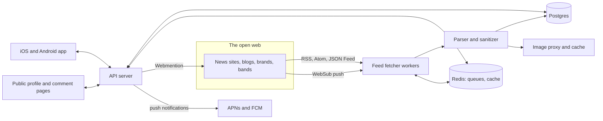

# indie-web-social-media-rss

**Follow websites, not accounts.** A mobile app for the open web. You follow sites instead of profiles. When a site publishes, its RSS post appears in your feed automatically, and you can comment on it, repost it, and follow the people you meet there. Profiles can be decorated the way MySpace pages could.

> Status: concept stage (November 2026). This repo holds three clickable HTML prototypes and this document. Nothing here is production code yet. The product name isn't chosen; see [Five names](#five-names).

## Contents

- [Prototypes](#prototypes)
- [What](#what)
- [Why](#why)
- [Who](#who)
- [Where](#where)
- [When](#when)
- [Three social models](#three-social-models)
- [Profile customization](#profile-customization)
- [Technical architecture](#technical-architecture)
- [Five names](#five-names)
- [Open questions](#open-questions)

## Prototypes

Open these in a browser. Every button works, and the phone-sized layouts also work on an actual phone.

| File | What it is |
| --- | --- |
| [`prototypes/index.html`](prototypes/index.html) | Overview: all three phones side by side, the comparison table, a recommendation and the name ideas |
| [`prototypes/option-a-commons.html`](prototypes/option-a-commons.html) | **Option A, Commons.** The open square: timeline, likes, reposts, public comments |
| [`prototypes/option-b-tidepool.html`](prototypes/option-b-tidepool.html) | **Option B, Tidepool.** Curators: daily editions, pools, margin notes, no likes |
| [`prototypes/option-c-porchlight.html`](prototypes/option-c-porchlight.html) | **Option C, Porchlight.** Neighborhoods: private porches, webrings, guestbooks |

Every site, person and post in the prototypes is invented. They're plain HTML, CSS and JavaScript with no build step. Profile customizations are saved in the browser's local storage.

## What

A mobile RSS reader with a social layer on top.

- **You follow websites.** News outlets, magazines, shows, bands, brands, webcomics, personal blogs. Anything with an RSS, Atom or JSON Feed.
- **Posts arrive by themselves.** When a site publishes, the new item from its feed becomes a post in the app. Nobody has to cross-post it.
- **People gather around those posts.** You can comment, repost, and follow other readers, so posts your friends share show up in your feed too.
- **Reading happens on the site.** "Read on site" opens the publisher's own page, so they get the visit, the ad impression or the subscription signup.
- **Your website is your account.** If you have a blog, your own posts show up as yours. Posting in this app means publishing on the web.
- **Profiles are yours to decorate.** Backgrounds, colors, fonts, a profile song, Top 8, a guestbook. It's MySpace energy, kept to your own page.

## Why

Most people who want to leave Instagram and X stay for the same reason: the outlets, shows, creators and brands they care about post there. The platforms became the only convenient place to follow everything at once.

Most of those publishers still run websites, and most of those websites still publish RSS feeds. The problem is that RSS readers are lonely. They have no friends, no comments and no profiles, so they've never replaced the social part.

This app tries to give people both:

1. **Everything in one feed**, pulled from the open web instead of a platform.
2. **The social part**, built around websites instead of replacing them.

If it works, attention and traffic flow back to independent sites, people discover the web by following links again, and leaving a platform no longer means losing the news.

Design principles that follow from this:

- No ranking algorithm. Posts appear in the order they were published, and the feed ends.
- Send people to websites. Never copy a full article the publisher didn't put in their feed.
- Your follows are portable. Import and export them as OPML at any time.
- No engagement bait. No streaks, no "you might have missed" pushes, and (in two of the three models) no public like counts.

## Who

**Primary users**

- People who want off Instagram, X, TikTok or Facebook but stay for news, entertainment and brands.
- People who already use RSS and wish it had friends in it.
- The MySpace, LiveJournal and Tumblr generation who miss weird, personal corners of the web.
- Friend groups and hobby communities who share links in group chats today.

**Secondary users**

- **Publishers and brands** that want readers on their own site rather than renting reach from a platform. They can verify their site and reply as themselves.
- **Independent creators** (bloggers, bands, webcomic artists, newsletter writers) whose website becomes the place their audience follows them.

**Team.** Not decided yet. Roles to fill are listed under [Open questions](#open-questions).

## Where

- **iOS and Android first.** Phones are where the scrolling habit lives, so that's where a better habit has to live too.
- **Public web pages for profiles and comments.** Every profile and public comment gets a URL (for example `app.example/@rowan`). That makes profiles shareable, and it's required for Webmention, which needs a public page to point at.
- **A web app later.** The same feed in a desktop browser.
- **The content stays on the open web.** The app is a window onto sites, not a place that hosts their articles.

## When

The project is at the concept stage. These phases are a proposed order. None have dates yet.

| Phase | Scope |
| --- | --- |
| 0. Concept (now, Nov 2026) | Three prototypes, pick a social model and a name |
| 1. Reader core | Accounts, follow by URL or @handle, feed ingestion, chronological feed, read on site, OPML import and export. Private beta on TestFlight and Play internal testing. |
| 2. Social v1 | Follow people, comments, reposts or pass-alongs (depending on the model chosen), first version of profile customization |
| 3. Publisher tools | Site verification, badged replies, click-through stats for site owners |
| 4. Open web interop | Webmention, IndieAuth sign-in, ActivityPub, plus porches, webrings or pools depending on the model |

Day to day, the app is meant for the moments people currently fill with a social feed: the morning check, the commute, the evening wind-down. Then it runs out, by design.

## Three social models

All three share the same reader core. They differ in what people do together around a post.

| | A · Commons | B · Tidepool | C · Porchlight |
| --- | --- | --- | --- |
| **Idea** | The open square | Curators and margin notes | Porches and webrings |
| **Home feed** | Chronological timeline of site posts and reposts | Morning and evening editions in sections | "Since last night" list that ends, with porch talk mixed in |
| **Reactions** | Likes with public counts | None (private weekly stats only) | None in public |
| **Sharing** | Repost and quote repost | "Pass along" needs a sentence. Pools (public collections). | "Hand to" specific friends or porches |
| **Comments** | Public threads, badged publisher replies | Margin notes on specific paragraphs | Private porch threads, optional public reply to the author's site via Webmention |
| **People** | Follow anyone, counts shown | Follow people and pools, no counts | Friends and invite-only porches (max 50) |
| **Discovery** | Starter packs, "sites your people read" | Pools, blogrolls | Webrings, surfed with prev and next |
| **Profile** | Themes, accent, font, song, Top 8 sites | Homepage layouts, paper, safe CSS box, blogroll | Full MySpace: tiles, glitter, Top 8 friends, guestbook, counter, 88×31 badges |
| **Feels like** | X, Threads, Bluesky | Are.na, Pocket, Tumblr | MySpace, group chats, GeoCities |
| **Best for** | Fastest switch from X and Instagram | Readers. Useful before your friends join. | Friend groups and hobby communities |
| **Biggest risk** | Drifts back to engagement chasing | Less familiar, slower to grow | Hard to start without friends already there |

**Recommendation:** launch with Commons' feed and public comments, since familiarity is what gets people to switch, but without public like counts. Add porches and webrings once people have friends on the app. Pools are cheap to add any time, since they're saved lists of posts.

## Profile customization

Profiles are the most visible way this app differs from the big platforms, and the most fun thing to share.

What users can change (union of the three prototypes):

- Background: preset patterns and tiles, solid colors, later uploaded images
- Panel colors, accent color, highlighter color
- Font, from a curated list
- Name effects: glow, rainbow, glitter
- Layout: zine, scrapbook, index, or a classic MySpace box layout
- Sections: about me, who I'd like to meet, mood, headline, profile song, Top 8 (friends or sites), blogroll, badges, guestbook, visitor counter
- "Advanced CSS": a short list of safe variables only (see below)

Rules that keep it fun without breaking the app:

- **Customization only applies to your profile page.** Feeds, posts and comments always use the app's readable default styles.
- **Songs never autoplay.**
- **Viewers can turn effects off.** A "reduce effects" setting removes animation and glitter on every profile they visit, and the app respects the system reduced-motion setting.
- **Contrast check.** The editor warns when text would be hard to read on the chosen background.

## Technical architecture

### Overview



### Proposed stack

| Layer | Choice | Why |
| --- | --- | --- |
| Mobile app | React Native with Expo, TypeScript | One codebase for iOS and Android. The prototypes' layouts translate directly. |
| API | TypeScript on Node (Fastify) | Same language as the app, so types are shared across the stack |
| Workers | Node workers on a Redis-backed job queue (BullMQ) | Feed fetching is many small scheduled jobs |
| Database | PostgreSQL | Relational data with strong indexing. Full-text search covers the first version. |
| Cache and queues | Redis | Job scheduling, rate limits, first-page timeline cache |
| Images | S3-compatible storage plus a resizing proxy | Thumbnails and favicons cached once, tracking parameters stripped |
| Push | APNs and FCM through Expo Notifications | Replies and mentions only |
| Auth | Email magic links, Sign in with Apple and Google, IndieAuth later | IndieAuth lets people sign in with their own domain |
| Public pages | Server-rendered HTML with microformats (h-card, h-entry) | Shareable profiles, and a source URL for Webmentions |

These are defaults to start from, not decisions. Python (feedparser is very tolerant of broken feeds) or Go would also suit the workers.

### Feed ingestion

1. **Discovery.** Given a URL, fetch the page and read `<link rel="alternate">` tags for RSS, Atom and JSON Feed. If there are none, try common paths (`/feed`, `/rss`, `/rss.xml`, `/atom.xml`, `/feed.xml`, `/index.xml`). Platform-specific patterns cover YouTube channels, Substack, Medium, Tumblr, WordPress and Mastodon accounts.
2. **Fetching.** Conditional GET with `ETag` and `If-Modified-Since`, so unchanged feeds cost almost nothing. Each feed has its own polling interval, from about 15 minutes for busy news sites to 24 hours for quiet blogs, adjusted by how often it posts and how many people follow it. Back off on errors and honor `Retry-After`. The User-Agent names the app and the subscriber count so publishers know who is fetching.
3. **Push.** If a feed advertises a WebSub hub (`<link rel="hub">`), subscribe and receive new posts within seconds instead of polling.
4. **Parsing.** Accept RSS 2.0, RSS 1.0, Atom and JSON Feed, and tolerate common breakage such as bad dates, relative URLs and broken encodings.
5. **Normalization.** Each item becomes a `post`: guid, canonical URL, title, summary, optional full content, author, published time, image (enclosure, `media:content`, or the page's `og:image` fetched lazily) and categories.
6. **Deduplication.** By guid, then by a hash of the canonical URL, to cope with feeds that change guids or republish items.
7. **Sanitizing.** Feed HTML runs through an allow-list sanitizer. Scripts, iframes, inline styles and tracking pixels are removed.
8. **Content policy.** Show what the feed provides, nothing more. Summary-only feeds stay summary-only, and every post links to the original. Publishers who ask to be removed are removed.

### Finding the website behind an @handle

The "paste an Instagram or X handle" feature has to work without scraping those platforms, which their terms forbid. It uses sources that sites publish themselves:

- **`rel="me"` links.** Many sites link to their social profiles with `rel="me"`. When the crawler indexes a site, it records those links, so `@meridianwire` resolves to the site that claims it.
- **Publisher claims.** Verified site owners list their social handles.
- **A curated directory.** Seeded by hand for large outlets and brands, then grown through user suggestions that get reviewed.

If an outlet has no feed at all, the app says so and offers to notify the user when one appears. A sitemap-based fallback could come later, but only for publishers who opt in.

### Data model

A sketch of the core tables. Model-specific tables are marked.

```
users            id, handle, display_name, email, own_site_id, created_at
profiles         user_id, theme (jsonb), sections (jsonb), about, mood, song_url
sites            id, domain, name, icon_url, verified_owner_id, kind
site_handles     site_id, platform, handle, source (rel_me | publisher | curated)
feeds            id, site_id, url, format, etag, last_modified, hub_url,
                 fetch_interval, next_fetch_at, error_count
posts            id, feed_id, site_id, guid, url, title, summary, content_html,
                 image_url, author, published_at, url_hash
site_follows     user_id, site_id, created_at
user_follows     follower_id, followee_id, created_at
comments         id, post_id, user_id, parent_id, body, visibility,
                 group_id (C), paragraph_index (B), quote (B), created_at
reposts          id, user_id, post_id, note, created_at    (A: quote, B: pass-along note)
reactions        user_id, post_id, kind                    (A)
collections      id, owner_id, title, description, visibility        (B: pools)
collection_items collection_id, post_id, note, added_at              (B)
groups           id, name, owner_id, max_members (50)                (C: porches)
group_members    group_id, user_id, role
group_messages   id, group_id, user_id, body, post_id, created_at    (C)
rings            id, name, keeper_id, badge_url                      (C: webrings)
ring_sites       ring_id, site_id, position                          (C)
guestbook        profile_user_id, author_id, body, created_at
webmentions      id, direction, source_url, target_url, status
```

### Building the home feed

- **Site posts use fan-out on read.** A site with 200,000 followers publishes once, and the post is stored once. The home query reads recent posts from the sites a user follows, using an index on `(site_id, published_at desc)`. This holds up to a few thousand follows per user.
- **People's activity** (reposts, pass-alongs, hand-offs) is read the same way from the people a user follows.
- **The two lists are merged** with `UNION ALL ... ORDER BY published_at DESC`, paginated with a cursor, and the first page is cached in Redis for about a minute.
- **"You're all caught up"** is the user's last-seen timestamp.
- **Editions** (Tidepool) are materialized at 7 am and 6 pm in the user's time zone.
- If people activity outgrows reads, move only that part to fan-out on write.

### Open web interoperability

| Standard | Use |
| --- | --- |
| OPML | Import and export follows, compatible with every RSS reader |
| WebSub | Instant delivery from feeds that support it |
| Webmention | Send public replies to the author's own site (Porchlight's "also reply on the site"), and accept mentions back |
| Microformats | Mark up public profiles and comments so other sites can read them |
| IndieAuth and `rel="me"` | Sign in with your own domain and prove you own your website |
| ActivityPub | Later: let Mastodon and other fediverse users follow profiles here, and read sites that publish over ActivityPub (WordPress and Ghost both can) |

### Publisher verification

A site owner proves ownership with any one of: a DNS TXT record, a `<meta>` tag on the homepage, a file under `/.well-known/`, or a `rel="me"` link from the site to their profile here. Verified sites get a badge, can reply as the site, can pin or hide comments on their own posts, and can see aggregate click-through numbers (how many readers went to the site). They never get individual reading histories.

### Profile rendering and safety

- Themes are stored as versioned JSON and rendered **natively** in the app, with no WebView and no user HTML. That keeps profiles fast and accessible and removes a whole class of security problems.
- The "advanced CSS" box accepts only an allow-list of variables (color, tilt, radius and similar). It's parsed on the server, and anything outside the list is dropped, including `url()`, imports, selectors and expressions.
- Fonts come from a curated list. Uploaded images and songs go through size limits, known-abuse hash matching and a content classifier before they appear.
- Public profile pages on the web render the same JSON into HTML under a strict Content Security Policy.

### Moderation and safety

- Block, mute and report everywhere. Rate limits and lower limits for new accounts.
- Verified publishers moderate the threads on their own posts.
- Porches have admins and are invite-only, with a 50-person cap.
- A spam classifier screens comments, plus a notice-and-takedown process for user content.
- Reading history isn't sold or used for ads. The app keeps as little of it as it can, and stores some only on the device.

### Notifications

Only replies, mentions, new followers and porch messages. Never "you might have missed" pushes, streaks or re-engagement nudges.

## Five names

The prototypes each use a different candidate so you can see three of them in context.

| Name | Idea | Used in |
| --- | --- | --- |
| **Commons** | The open web as shared land instead of a platform's property. Civic and plain, and it sits well next to news outlets and brands. | Option A |
| **Tidepool** | New posts wash in with the tide, and each site is its own small ecosystem. A nod to surfing the web. | Option B |
| **Porchlight** | A light on means someone is home. Warm, neighborly, a good fit for small groups. | Option C |
| **Webring** | Brings back the 90s loop of linked sites. People who remember them get it at once. | |
| **Guestbook** | Every post becomes a page you can sign. Puts comments and MySpace-era profiles at the center. | |

All five are common words. Other companies probably use some of them, and no domains or app-store names have been checked. Run a trademark and app-store search before choosing one.

## Open questions

- Which social model, or which mix, to build first?
- Business model: paid tier for premium profile themes and extras, publisher tools, or both? No ads is assumed.
- Should the app host simple blogs for people who don't have a website, so everyone can post?
- How should paywalled feeds work (summary only, or sign in to the publisher inside the in-app browser)?
- How much of the comment layer should be public on the web versus visible only inside the app?
- Hiring: mobile engineer, backend engineer (feeds and infrastructure), designer, community and moderation lead.
